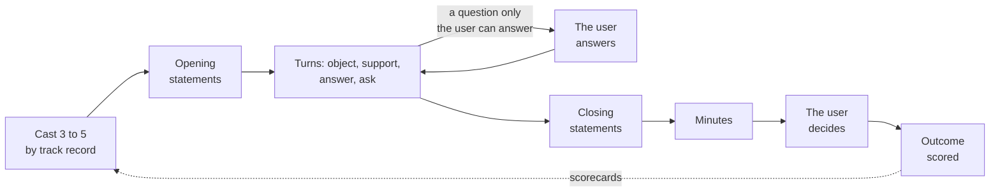

# persona-debate-lab

<!-- bnitech:card -->
- **Problem:** Multi-persona AI debates end in a transcript, and nobody checks whose ideas held up or got used.
- **Who it helps:** Anyone who uses Claude Code to think a decision through from several sides.
- **Try it (about 10 minutes):** Clone this repo, copy `skill/` to `~/.claude/skills/idea-debate/`, give it the two paths in the Settings table of `skill/SKILL.md` (your clone, and a private folder for notes), then ask Claude Code to debate a decision you face.
<!-- /bnitech:card -->

A method for running multi-persona AI debates as meetings with the user in the room, and scoring
the personas against what actually happened afterwards.

Most persona debates stop at the transcript. This repo keeps the parts that make the next debate
better: one roster of personas with their known biases, a scorecard per persona (did their ideas
survive rebuttal, did they misread facts, did the user end up using their ideas, did it work),
the protocol, and the lessons learned.

- `METHOD.md`: how a meeting runs, step by step
- `personas/roster.md`: the cast
- `scorecards/rounds.csv`: one row per persona per round, counts only
- `scorecards/outcomes.csv`: one row per round, with the user's 1 to 5 rating of how useful it was
- `lessons/LESSONS.md`: what changed the method and why
- `skill/`: the Claude Code skill that runs meetings, its templates, `score.py` and a chat mirror
- `guard/`: the privacy guard that keeps personal details out of this repo

## How a meeting runs

The personas talk to each other in turns, and each one keeps its memory for the whole meeting.
When one needs a fact or a decision only the user has, the meeting stops and asks the user, and
the answer goes to everyone. The moderator has no opinion: it gives the floor, flags misread facts
as they happen, and writes minutes that hold only what was said in the room. When the real event
has happened, the outcome goes back into each persona's scorecard, so the next cast picks better.
`METHOD.md` has every step.

## Track record

<!-- scoreboard:start -->
| persona | rounds | proposals | survival | fact errors | adopted | hit rate |
|---|---|---|---|---|---|---|
| `startup-cto` | 2 | 6 | 67% | 1 | 0 | 0% |
| `sre-oncall` | 1 | 2 | 100% | 0 | 0 | n/a |
| `solo-indie` | 5 | 14 | 57% | 3 | 1 | 0% |
| `data-engineer` | 5 | 11 | 82% | 1 | 0 | n/a |
| `backend-junior` | 2 | 4 | 100% | 1 | 0 | n/a |
| `tech-lead-mid` | 1 | 2 | 100% | 0 | 0 | n/a |
| `cost-controller` | 1 | 2 | 0% | 0 | 0 | n/a |
| `consultant` | 2 | 4 | 50% | 1 | 0 | 0% |
| `platform-vendor` | 2 | 4 | 25% | 1 | 0 | n/a |
| `product-manager` | 2 | 7 | 57% | 1 | 0 | n/a |
| `security-officer` | 1 | 2 | 100% | 0 | 0 | n/a |
| `migration-veteran` | 3 | 7 | 86% | 0 | 0 | n/a |
| `oss-maintainer` | 2 | 4 | 75% | 0 | 0 | n/a |
| `hiring-manager` | 7 | 18 | 67% | 0 | 0 | n/a |
| `wh-settler` | 1 | 2 | 50% | 0 | 0 | n/a |
| `paperwork-agent` | 1 | 2 | 50% | 0 | 0 | n/a |
| `product-designer` | 4 | 11 | 55% | 1 | 1 | 100% |
| `llm-app-engineer` | 2 | 4 | 75% | 0 | 0 | n/a |
| `learning-scientist` | 3 | 6 | 50% | 1 | 1 | 100% |
| `agent-engineer` | 4 | 8 | 75% | 1 | 0 | 0% |
| `indie-game-designer` | 1 | 3 | 100% | 0 | 2 | 100% |
| `course-creator` | 1 | 2 | 50% | 0 | 0 | n/a |
| `creative-director` | 1 | 2 | 50% | 0 | 0 | 0% |
| `trend-scout` | 1 | 2 | 50% | 0 | 1 | 100% |

Method: 3 rated round(s), 9 awaiting an outcome; average rating 3.3 of 5; ideas used 29%.
<!-- scoreboard:end -->

## Privacy

Debates are about real decisions, so transcripts stay private. This repo holds only the method and
counts. `guard/check_public.py` blocks Hangul, contact details, money amounts, links outside an
allowlist, a private list of names, files it cannot read as text, and any path outside the expected
layout. It runs in the pre-commit, commit-msg and pre-push hooks (install them once per clone with
`sh guard/install-hooks.sh`) and in CI, which checks every commit of a push or pull request, not
only the final snapshot. Before a push it also checks the name of every branch and tag being pushed
and the message of every annotated tag, and CI checks the tag message again on a tag push. Pull
requests from forks fail the guard, because the private list is a repository secret that forks
cannot read.

What the guard cannot see:

- Only Hangul is blocked, not every script other than English. Text in another script passes the
  script check; only the private list of names still applies to it.
- It reads one line, or one name, at a time, so a value split into pieces and joined in code (a
  phone number built from string concatenation, for one) passes unseen. The tests build their
  fixtures exactly that way so the guard does not flag the tests themselves. That is why every
  fixture must be a reserved fiction value and nothing else: phone numbers 555-0100 to 555-0199,
  reserved example domains such as example.org or the .invalid ending, and plainly made-up amounts
  such as 4,321. Never put a value from anyone's records into a test, whole or split.

## License

MIT
